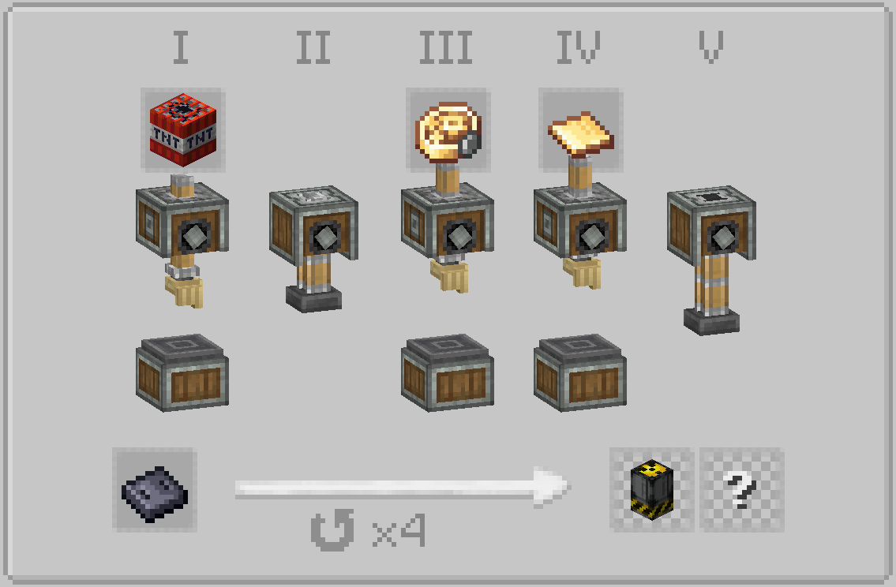

# ☢️ Create: Nuclear Shell [ARCHIVED]


> *"Now I am become Death, the destroyer of worlds."*
> ― J. Robert Oppenheimer

---

## 🛣️ ROAD MAP & PROJECT STATUS

> **⚠️ Notice:**  
> **Create: Nuclear Shell** is transitioning to **ARCHIVED** status.

### 🔄 Final Updates
Before support is discontinued, a few final minor versions will be released to polish the current content:

| Status | Feature | Description |
| :---: | :--- | :--- |
| ✅ | **v3.1.0** | Alex's Caves dependency removed, new crafting recipe, reworked detonation. |
| ✅ | **v3.1.1** | Polish release: fixed tooltips, tag & datapack errors, explosion scheduling and clean-up of removed content. |
| ❌ | **Multiple Warhead Types** | Canceled for this mod (Tactical nukes, dirty bombs, etc.). |
| ❌ | **Configurable Yield** | Canceled for this mod (Adjust explosion power via config). |
| ❌ | **New Crafting Chains** | Canceled for this mod (Uranium processing, bomb assembly). |
| ❌ | **Independence** | Canceled for this mod (Removal of Alex's Caves dependency — done in v3.1.0). |

---

### 🛑 End of Support
Following the final minor releases, active development and support for **Create: Nuclear Shell** will **cease completely**:
- No further bug fixes or patches.
- No ports to newer Minecraft versions.
- No new features will be added.

---

### 🚀 Successor Project
All planned features, major overhauls, and future updates are being moved to **a new standalone successor project** built on **NeoForge** without the **Alex's Caves** dependency.

> 🔗 **Check out the new project:** *[SOON]*

---

## 🔍 About

**Create: Nuclear Shell** is a high-impact expansion for **Create: Big Cannons** that introduces nuclear artillery capable of catastrophic destruction. Perfect for end-game content or apocalyptic modpacks.

---

## ⚙️ Technical Details

| Category         | Details                                                        |
|------------------|-----------------------------------------------------------------|
| **MC Version**   | 1.20.1                                                          |
| **Loader**       | Forge 47.x                                                      |
| **Dependencies** | Create 6.0.6, Create: Big Cannons 5.9, Ritchie's Projectile Lib |
| **License**      | MIT                                                             |

---

## 💥 Features

### ✅ Current Features

- 💣 Nuclear artillery shell with massive explosion radius
- ☢️ Radiation, poison and blinding for everyone caught in the blast
- 🌋 Devastating mushroom cloud with fire and screen shake
- 🕳️ Crater that is dug progressively, block by block
- 🧪 Sequenced assembly crafting recipe for the shell
- ⌨️ `/nuke [radius]` command for testing (operator permission level 2)

---

## 🌍 Translations

We welcome community translations! Here's how to contribute:

1. Copy this template and replace with your translations:
    ```json
    {
      "itemGroup.canonnukes": "Create: Nuclear Shell",
      "block.canonnukes.nuke_shell": "Nuclear Shell",
      "block.canonnukes.nuke_shell.tooltip.summary": "\"Now, I am become _Death_, the destroyer of worlds.\"",
      "block.canonnukes.nuke_shell.tooltip.condition1": "§cImportant",
      "block.canonnukes.nuke_shell.tooltip.behaviour1": "§cA §cfuse §cis §c§l_required_ §cfor §cdetonation - §cit will §c§l_NOT_ §cexplode §con §cits §cown.",
      "block.canonnukes.nuke_shell.tooltip.condition2": "On Detonation",
      "block.canonnukes.nuke_shell.tooltip.behaviour2": "Unleashes a powerful nuclear blast, devastating the immediate area in an inferno and irradiating the surrounding environment.",
      "entity.canonnukes.nuke_shell_projectile": "Nuclear Shell",
      "item.canonnukes.incomplete_nuke_shell": "Incomplete Nuclear Shell",
      "commands.canonnukes.nuke.success": "[!] Nuclear blast executed (radius: %s)"
    }
    ```

2. Name the file using locale codes (e.g., `fr_fr.json`, `uk_ua.json`)

3. Submit a Pull Request

### ✅ Supported Languages

- ✅ English
- ✅ German
- ✅ Russian
- ✅ Ukrainian
- ✅ Chinese
- 🚧 Other

---

## 📜 Changelog

### v3.1.1

- 🐛 Fixed the nuclear shell tooltip (it used the translation keys of the old mod id).
- 🐛 Fixed the `ritchiesprojectilelib:precise_motion` tag, it pointed to a block instead of the projectile entity.
- 🐛 Removed invalid `munition_properties` files that referenced a non existing entity type.
- 🐛 The crater is now really dug over multiple ticks instead of instantly, the mushroom cloud animation works as intended.
- 🐛 Fluids, bedrock and other unbreakable blocks are no longer deleted by the blast, neighbouring blocks update correctly.
- 🐛 The `/nuke` command no longer sends a broken message and its radius is limited to a safe value.
- 🧹 Removed leftovers of the canceled reactor / uranium features (blocks, models, textures and worldgen data).

### v3.1.0

- 🔗 **Removed Alex's Caves dependency** — the mod is now standalone relative to Alex's Caves.
- 🛠️ Changed crafting recipe for the nuclear shell.
- 💥 Reworked detonation mechanics and explosion type.
- 📌 **Note:** Version 3.1.0 will serve as the base for future porting!

### v3.0.0

- Initial release
- Basic nuclear shell functionality

---

## ❓ FAQ

- **Q:** *When will the developer add answers here?*  
  **A:** I don't know when I want to.

- **Q:** *How to craft a bomb in the third version of the mod?*  
  **A:** It's simple  
  

---

## 📦 Download

### v3.0.0 1.20.1 (only nuclear shell)
[](https://modrinth.com/mod/create-nuclear-shell/version/3.0.0)  
[](https://www.curseforge.com/minecraft/mc-mods/create-nuclear-shell/files/6660771)

---

> *"We knew the world would not be the same."*
