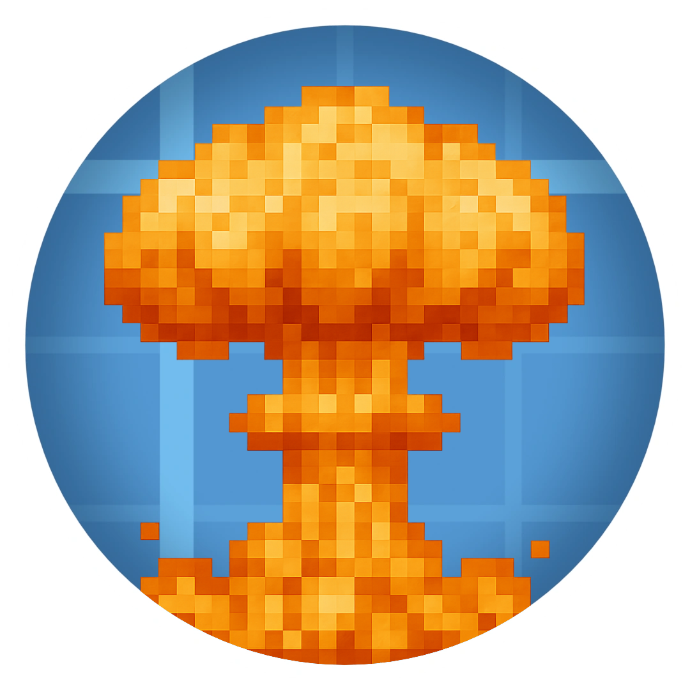
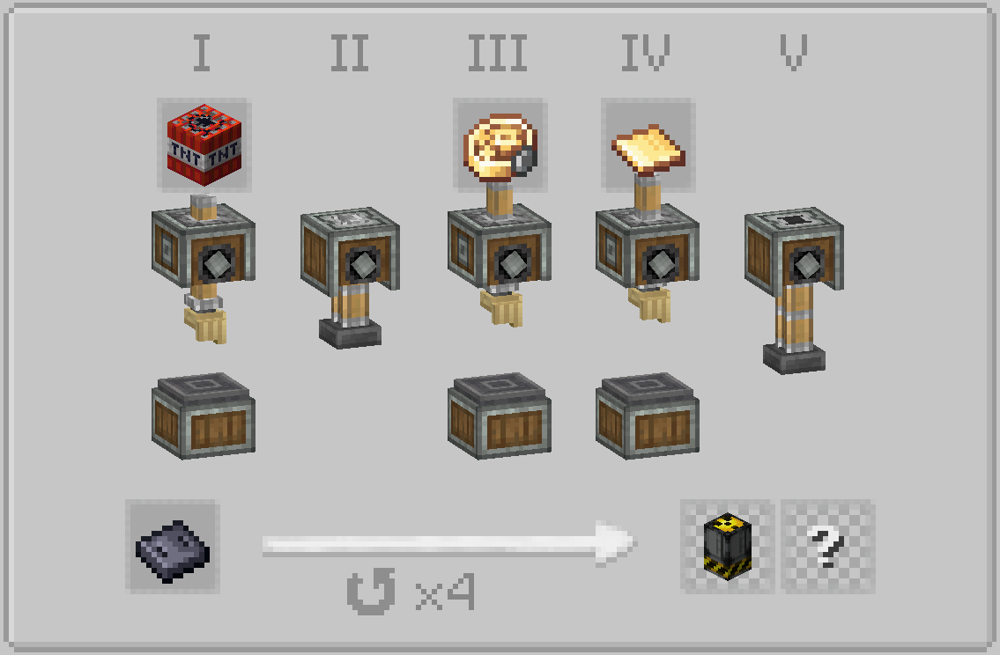

# ☢️ Create: Nuclear Shell [ARCHIVED]



> *"Now I am become Death, the destroyer of worlds."*
> ― J. Robert Oppenheimer

---

## 🛣️ ROAD MAP & PROJECT STATUS

> **⚠️ Notice:**  
> **Create: Nuclear Shell** is transitioning to **ARCHIVED** status.

### 🔄 Final Updates
Before support is discontinued, a few final minor versions will be released to polish the current content:

| Status | Feature | Description |
| :---: | :--- | :--- |
| 🟡 | **Final Polish** | Minor bug fixes and performance adjustments for the current build. |
| 🟡 | **Minor Version Releases** | Final patch updates to fix critical issues and improve compatibility. |
| ❌ | **Multiple Warhead Types** | Canceled for this mod (Tactical nukes, dirty bombs, etc.). |
| ❌ | **Configurable Yield** | Canceled for this mod (Adjust explosion power via config). |
| ❌ | **New Crafting Chains** | Canceled for this mod (Uranium processing, bomb assembly). |
| ❌ | **Independence** | Canceled for this mod (Removal of Alex's Caves dependency). |

---

### 🛑 End of Support
Following the final minor releases, active development and support for **Create: Nuclear Shell** will **cease completely**:
- No further bug fixes or patches.
- No ports to newer Minecraft versions.
- No new features will be added.

---

### 🚀 Successor Project
All planned features, major overhauls, and future updates are being moved to a **new standalone successor project** built on **NeoForge** without the **Alex's Caves** dependency.

> 🔗 **Check out the new project:** *[SOON]*

---

## 🔍 About

**Create: Nuclear Shell** is a high-impact expansion for **Create: Big Cannons** that introduces nuclear artillery capable of catastrophic destruction and lingering radiation effects. Perfect for end-game content or apocalyptic modpacks.

---

## ⚙️ Technical Details

| Category         | Details                           |
|------------------|-----------------------------------|
| **MC Version**   | 1.20.1                            |
| **Dependencies** | Create: Big Cannons, Alex's Caves |
| **License**      | MIT                               |

---

## 💥 Features

### ✅ Current Features

- 💣 Nuclear artillery shell with massive explosion radius
- ☢️ Radiation zones that persist after detonation
- 🌋 Secondary firestorms and environmental damage

---

## 🌍 Translations

We welcome community translations! Here's how to contribute:

1. Copy this template and replace with your translations:
    ```json
    {
      "block.canonnukes.nuke_shell": "Nuclear Shell",
      "block.createnukecannon.nuke_shell.tooltip.behaviour2": "Unleashes a powerful nuclear blast, devastating the immediate area in an inferno and irradiating the surrounding environment.",
      "block.createnukecannon.nuke_shell.tooltip.condition2": "On Detonation",
      "block.createnukecannon.nuke_shell.tooltip.behaviour1": "§cA §cfuse §cis §c§l_required_ §cfor §cdetonation - §cit will §c§l_NOT_ §cexplode §con §cits §cown.",
      "block.createnukecannon.nuke_shell.tooltip.condition1": "§cImportant",
      "block.createnukecannon.nuke_shell.tooltip.summary": "\"Now, I am become _Death_, the destroyer of worlds.\"",
      "entity.canonnukes.nuke_shell": "Nuclear Shell"
    }
    ```

2. Name the file using locale codes (e.g., `fr_fr.json`, `uk_ua.json`)

3. Submit a Pull Request

### ✅ Supported Languages

- ✅ English
- ✅ Russian
- ✅ Ukrainian
- ✅ Chinese
- 🚧 Other

---

## 📜 Changelog

### v3.1.0 *(Target for Porting)*

- 🔗 **Removed Alex's Caves dependency** — the mod is now standalone relative to Alex's Caves.
- 🛠️ Changed crafting recipe for the nuclear shell.
- 💥 Reworked detonation mechanics and explosion type.
- 📌 **Note:** Version 3.1.0 will serve as the base for future porting!

### v3.0.0

- Initial release
- Basic nuclear shell functionality

---

## ❓ FAQ

- **Q:** *When will the developer add answers here?*  
  **A:** I don't know when I want to.

- **Q:** *How to craft a bomb in the third version of the mod?*  
  **A:** It's simple  
  

---

## 📦 Download

### v3.0.0 1.20.1 (only nuclear shell)
[](https://modrinth.com/mod/create-nuclear-shell/version/3.0.0)  
[](https://www.curseforge.com/minecraft/mc-mods/create-nuclear-shell/files/6660771)

---

> *"We knew the world would not be the same."*