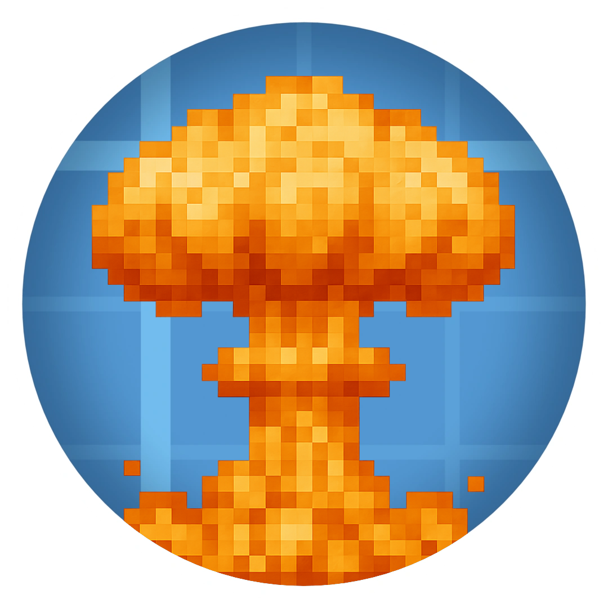

# ☢️ Create: Nuclear Shell — NeoForge Edition



> *"Now I am become Death, the destroyer of worlds."*
> ― J. Robert Oppenheimer

---

## 🔍 About

**Create: Nuclear Shell** is a high-impact expansion for **Create: Big Cannons** that introduces
nuclear artillery capable of catastrophic destruction. Perfect for end-game content or apocalyptic
modpacks.

This is the **NeoForge** edition of the mod, it replaces the archived Forge 1.20.1 version and
does **not** depend on Alex's Caves anymore.

---

## ⚙️ Technical Details

| Category         | Details                                                        |
|------------------|-----------------------------------------------------------------|
| **MC Version**   | 1.21.1                                                          |
| **Loader**       | NeoForge 21.1+                                                  |
| **Java**         | 21                                                              |
| **Dependencies** | Create 6.0.10, Create: Big Cannons 5.11, Ritchie's Projectile Lib |
| **License**      | MIT                                                             |

---

## 💥 Features

- 💣 Nuclear artillery shell with a massive explosion radius
- ☢️ Radiation, poison and blinding for everyone caught in the blast
- 🌋 Devastating mushroom cloud with fire and screen shake
- 🕳️ Crater that is dug progressively, block by block
- 🧪 Sequenced assembly crafting recipe for the shell
- ⌨️ `/nuke [radius]` command for testing (operator permission level 2)
- ⚙️ Configurable blast radius, damage, radiation, crater and screen shake

### ⚙️ Configuration

The config file is `config/canonnukes-common.toml`:

| Key                                    | Default | Description                                       |
|----------------------------------------|---------|---------------------------------------------------|
| `explosion.blastRadius`                | `35.0`  | Blast radius of the nuclear shell in blocks       |
| `explosion.damageMultiplier`           | `1.0`   | Multiplier for the damage dealt to entities       |
| `explosion.destroyBlocks`              | `true`  | Whether the blast digs a crater                   |
| `explosion.craterSteps`                | `40`    | Amount of steps the crater is dug over           |
| `explosion.craterStepInterval`         | `2`     | Ticks between two steps of the crater             |
| `effects.radiation`                    | `true`  | Whether the blast irradiates entities             |
| `effects.radiationDuration`            | `800`   | Duration of the radiation in ticks (20 = 1s)     |
| `effects.screenShake`                  | `true`  | Whether the blast shakes the screen               |
| `effects.mushroomCloud`                | `true`  | Whether the mushroom cloud is rendered            |

---

## 🌍 Translations

We welcome community translations! Here's how to contribute:

1. Copy this template and replace with your translations:
    ```json
    {
      "itemGroup.canonnukes": "Create: Nuclear Shell",
      "block.canonnukes.nuke_shell": "Nuclear Shell",
      "block.canonnukes.nuke_shell.tooltip.summary": "\"Now, I am become _Death_, the destroyer of worlds.\"",
      "block.canonnukes.nuke_shell.tooltip.condition1": "§cImportant",
      "block.canonnukes.nuke_shell.tooltip.behaviour1": "§cA §cfuse §cis §c§l_required_ §cfor §cdetonation - §cit will §c§l_NOT_ §cexplode §con §cits §cown.",
      "block.canonnukes.nuke_shell.tooltip.condition2": "On Detonation",
      "block.canonnukes.nuke_shell.tooltip.behaviour2": "Unleashes a powerful nuclear blast, devastating the immediate area in an inferno and irradiating the surrounding environment.",
      "entity.canonnukes.nuke_shell_projectile": "Nuclear Shell",
      "item.canonnukes.incomplete_nuke_shell": "Incomplete Nuclear Shell",
      "commands.canonnukes.nuke.success": "[!] Nuclear blast executed (radius: %s)"
    }
    ```

2. Name the file using locale codes (e.g., `fr_fr.json`, `uk_ua.json`)

3. Submit a Pull Request

### ✅ Supported Languages

- ✅ English
- ✅ German
- ✅ Russian
- ✅ Ukrainian
- ✅ Chinese
- 🚧 Other

---

## 📜 Changelog

### v3.1.1

- 🔧 **Ported to NeoForge 1.21.1.**
- 🐛 Fixed the crash when opening the creative menu, the shell was added to the tab twice.
- 🐛 Fixed the nuclear shell tooltip, it used the translation keys of the old mod id.
- 🐛 Fixed the `ritchiesprojectilelib:precise_motion` tag, it pointed to a block instead of the projectile entity.
- 🐛 Removed invalid `munition_properties` files that referenced a non existing entity type.
- 🐛 The crater is now really dug over multiple ticks instead of instantly, the mushroom cloud animation works as intended.
- 🐛 Fluids, bedrock and other unbreakable blocks are no longer deleted by the blast, neighbouring blocks update correctly.
- 🐛 The `/nuke` command no longer sends a broken message and its radius is limited to a safe value.
- ⚙️ Replaced the placeholder config with real options for blast radius, damage, radiation, crater and screen shake.
- 🧹 Removed leftovers of the canceled reactor / uranium features (blocks, models, textures and worldgen data).

### v3.1.0 (Forge 1.20.1, archived)

- 🔗 **Removed Alex's Caves dependency** — the mod is now standalone relative to Alex's Caves.
- 🛠️ Changed crafting recipe for the nuclear shell.
- 💥 Reworked detonation mechanics and explosion type.

---

## 🛠️ Building from source

```bash
./gradlew build
```

The jar is written to `build/libs/canonnukes-<version>.jar`.

---

> *"We knew the world would not be the same."*
